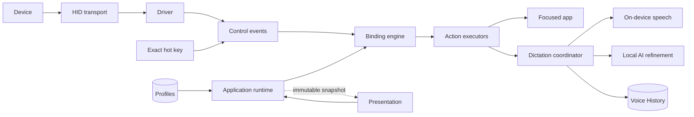

# Architecture

Detail and rationale live in the linked [decisions](decisions/); this page is
the current map.

## Shape

The top row is the latency-critical path. UI, persistence, and diagnostics
observe it and never block it.

## Stack

| Concern | Choice |
| --- | --- |
| Languages | Swift 6 strict concurrency; Rust (pinned) for portable Voice policy; C for narrow bridges. |
| UI | SwiftUI macOS shell and iOS app; UIKit keyboard extension. |
| Hardware | IOKit `IOHIDManager`, exclusive open of the exact VEC collection ([0004](decisions/0004_exclusive_vec_ownership.md)). |
| Synthetic input | `CGEvent`, guarded by Accessibility trust. Fallback chords use Carbon `RegisterEventHotKey` ([0018](decisions/0018_exact_keyboard_control_fallback.md)). |
| macOS speech | transcribe.cpp 0.4.1 with Parakeet TDT 0.6B v3 in an app-embedded XPC service (default); Apple `SpeechAnalyzer` (26+) or `SFSpeechRecognizer` (15–25) when chosen or as a fallback ([0060](decisions/0060_macos_transcribe_cpp_default_asr.md)). |
| iOS speech | transcribe.cpp 0.4.1 with Silero VAD ([0055](decisions/0055_transcribe_cpp_asr_runtime.md)). |
| Refinement | `SystemLanguageModel` (macOS 26+) or fixed-loopback Ollama ([0020](decisions/0020_local_ai_dictation.md), [0021](decisions/0021_local_ai_model_selection.md)). |
| Persistence | Versioned Codable JSON for configuration; system SQLite plus atomic CAF files for History. |
| Dependencies | Apple frameworks only in apps. Rust validators use serde and RustCrypto SHA-2, statically linked. |
| Tests | Swift Testing, XCTest, Rust tests, and real C consumers. |

## Components

| Component | Path | Owns | Invariant |
| --- | --- | --- | --- |
| Domain | `Sources/HardwareControllerCore` | Devices, Controls, events, Bindings, Profiles, `ProfileEdit`, interaction state, transcript policy. | No IOKit, AppKit, SwiftUI, Accessibility, file, or logging imports. |
| HID transport + Driver | `HardwareControllerMac/infinity_hid_manager.swift`, `HardwareControllerCore/infinity_3_driver.swift` | Exact matching, exclusive ownership, report decoding into `left`/`center`/`right`. | Only Drivers see vendor identity or report bytes; unsupported Devices are never seized. |
| Binding engine | `ControllerRuntime` | Pressed state, Momentary/Toggle, active-Action ownership. | Duplicates suppressed; every exit path ends active Actions once. |
| Application runtime | `HardwareControllerApp/application_runtime*.swift` | Lifecycle, Profile transactions, permissions, warm-up, snapshots. | Adopts a Profile only after its atomic write succeeds. |
| Process seam | `application_process.swift`, `live_application_process.swift` | Composition of HID, engine, executors, Dictation, hot keys. | Tests replace the whole seam, never UI callbacks. |
| Dictation | `OwnedTranscriptionController`, `LocalAIDictationController`, `DictationWorkflowCoordinator` | Capture, recognition, refinement, delivery, History commit. | One microphone owner process-wide; the hot path never awaits speech or models. |
| Voice History | `SQLiteVoiceSessionStore`, retention and reconciliation actors | Sessions, immutable results, CAF lifecycle. | Results are append-only; audio expiry never removes text. |
| Portable Voice core | `crates/voice_core`, `voice_models`, `voice_archive` | Retention policy, Model-package and archive verification. | No platform types; unsafe Rust denied outside `voice_ffi`. |
| Voice FFI | `crates/voice_ffi`, `Sources/hardware_controller_voice_ffi` | Versioned synchronous C ABI and typed Swift wrappers. | Caller owns every buffer; no pointer survives a call ([0035](decisions/0035_portable_voice_c_abi.md)). |
| ASR bridge | `Sources/voice_asr_bridge`, `Sources/voice_asr_runtime` | One transcribe.cpp model, session, and optional VAD session; `ASRKernel` is its typed Swift owner. | Typed failures for no speech and incomplete decode; never partial text. |
| Model downloads | `Sources/hardware_controller_model_download` | Pinned catalog, HTTPS-only fetcher, verifying package assembler for both apps. | The only network code besides the Ollama adapter; on explicit tap only ([0062](decisions/0062_shared_pinned_model_downloads.md)). |
| macOS ASR service | `Sources/hardware_controller_asr_service*`, `Contents/XPCServices/HardwareControllerASRService.xpc` | The only macOS code that links transcribe.cpp; revalidates the package digest, then decodes. | A ggml abort, Metal fault, or hang kills only this process; no entitlements. |
| Speech engine | `SpeechEngineSessionFactory`, `TranscribeCppSpeechEngine`, `TranscribeCppSpeechRecognitionSession` | Engine selection, supervision (deadline, CPU retry, disable after two crashes, idle kill), Apple fallback from the buffered recording. | A missing package refuses the session; it never silently uses Apple. Every fallback is announced and recorded. |
| Presentation | `HardwareControllerApp` views and models | Main-actor rendering of snapshots; forwards intents. | Owns no hardware, transactions, or transcription lifecycle. |
| iOS app | `apps/ios/voice_input/app` | Microphone, audio, ASR, formatting, History, Live Activity. | The only process that links transcribe.cpp or touches audio. |
| iOS keyboard | `apps/ios/voice_input/keyboard` | QWERTY, voice status, one insertion attempt, bounded recovery. | Cannot record or launch the app; reads only the bounded handoff. |

## Flows

**Profile edits.** Every change is a `ProfileEdit` value. Pure
`ProfileEnvelope.applying(_:in:)` returns the candidate envelope and the
Profile the runtime must adopt, or a typed `ProfileEditFailure`. The runtime
saves atomically, installs the new resolver after cancelling active Actions,
then publishes. Inactive edits never touch the resolver.

**Local Dictation.** Begin captures the target and starts on-device
recognition. Stable Accessibility ranges get reversible live text; other
fields get final text; web and terminal targets get one guarded payload.
Finalization has a five-second watchdog.

**Local AI Dictation.** Recognition is final-only. Model preparation starts at
begin, off the hot path. Raw text → exact spoken edits → Dictionary
replacements → typed paragraph/list blocks from the provider → casing and list
normalization → validation of protected tokens and meaning → one rendering for
the captured target. Preparation plus generation share a three-second deadline;
on any failure the Edited text is delivered once if the target is still valid.
A bounded tee writes the CAF on a utility task; after delivery the session
commits Raw, Edited, Formatted, Delivered, and evidence to SQLite
([0020](decisions/0020_local_ai_dictation.md), [0054](decisions/0054_typed_local_ai_formatting_output.md)).

**Triggers.** Physical Controls, the Voice chord (hold or double-press latch),
and the menu-bar Record action all submit `DictationCommand`s to the same
serialized dispatcher ([0034](decisions/0034_voice_trigger_convergence.md)).

**iOS capture.** The containing app records a CAF and, in parallel, feeds a
live tap into pause-cut decoding so Stop waits only for the last chunk. The
recorded file is authoritative: an incomplete live result falls back to file
decoding ([0056](decisions/0056_ios_live_pause_cut_decoding.md)). History
commits before the result is published to the keyboard through a bounded,
this-device-only Keychain handoff with heartbeats, session identity, and
monotonic sequence numbers ([0040](decisions/0040_ios_keyboard_activation_and_handoff.md),
[0047](decisions/0047_ios_stale_service_recovery.md),
[0048](decisions/0048_ios_bounded_insertion_recovery.md)).

## Concurrency and latency

- HID and hot-key callbacks are timestamped at entry with a monotonic clock and
  run decode → resolve → dispatch on one user-interactive serial queue.
- Persistence, logging, main-actor publication, speech, and model work stay
  outside the measured callback-to-dispatch interval. Domain transitions are
  never coalesced; presentation updates may be.
- Microphone samples are copied before their callback returns; only immutable
  `Sendable` samples cross isolation. The audio queue is bounded at 32 buffers
  and overflow fails explicitly ([0011](decisions/0011_owned_speech_input_and_explicit_termination.md)).
- Audio engines are leased per device/rate/channel; a route change fails the
  session once and rebuilds ([0012](decisions/0012_configuration_aware_audio_capture.md)).
  An Objective-C boundary converts AVFAudio exceptions into typed errors.
- Sleep, disconnect, Profile switch, permission loss, and shutdown synthesize
  releases and end active Actions before state is discarded. Termination waits
  for Action cleanup and microphone release.

## Persistence

| Store | Format | Rules |
| --- | --- | --- |
| Profiles | `profiles.json`, schema 5 | Atomic replace; explicit migrations; corrupt files preserved and replaced by a safe default; newer schemas never overwritten. |
| Preferences | `preferences.json`, schema 7 | Same rules; separate from Profiles. |
| macOS History | `voice/` SQLite + CAF | Actor-owned connections with a five-second contention bound; startup reconciliation before retention ([0032](decisions/0032_voice_history_crash_recovery.md)); age/bytes/count/low-disk retention protects active, pinned, and recovery audio ([0031](decisions/0031_bounded_voice_history_audio.md)); one Rust retention policy for both platforms ([0057](decisions/0057_single_rust_retention_policy.md)). |
| iOS History | SQLite + CAF, Data Protection, excluded from backup | Commit before publish; same retention policy with iOS defaults ([0049](decisions/0049_ios_offline_storage_enforcement.md)). |
| Portable archive | `.voice_history` V1 directory | Verified in Rust before Swift restore; identical imports are no-ops ([0038](decisions/0038_portable_voice_history_archives.md)). |
| iOS Model packages | Private, Data Protection, no backup | Rust admission with digests and limits; never implicitly evicted ([0041](decisions/0041_ios_model_package_admission.md)); a pinned starter is bundled and admitted on first launch ([0061](decisions/0061_ios_bundled_starter_model.md)). |
| macOS Model package | `Application Support/…/SpeechModels`, one package plus `installed.json` | Pinned size and SHA-256 per file, then Rust admission; the record switches packages in one atomic rename. |

## Permissions and security

| Capability | Used for | Without it |
| --- | --- | --- |
| HID | The exact pedal collection. | Device stays disconnected. |
| Accessibility | Target capture, insertion, synthetic shortcuts, optional bounded context. | Physical state still shows; affected Actions are disabled. |
| Microphone | Capture during an owned Dictation session. | Both Dictation Actions disabled. |
| Speech Recognition | macOS 15–25 legacy recognizer, only when Apple is the chosen engine. | Apple Dictation disabled on those releases. |
| Loopback HTTP | Ollama at `127.0.0.1:11434` only. | Apple On-Device and non-AI Actions unaffected. |
| HTTPS download | One explicit, pinned speech-model download from Hugging Face; no Voice content. | Dictation stays off until the model is installed or Apple is chosen. |

- The direct build uses hardened runtime with only the audio-input entitlement;
  no App Sandbox. The ASR service has hardened runtime and no entitlements, and
  links only Apple libraries plus its bundled, pinned `CTranscribe.framework`.
- Providers declare locality (`inProcess`, `fixedLoopback`, `remoteCapable`);
  the router rejects `remoteCapable` before any call ([0033](decisions/0033_local_only_voice_enforcement.md)).
- Ollama uses an ephemeral session with no proxy, redirects, or cache, and a
  pinned model digest.
- Speech content, context, and prompts are never logged. Nearby context is off
  by default and capped at 600 UTF-16 units from a nonsecure multiline field.
- iOS product sources are scanned for network clients and capabilities on every
  check ([0049](decisions/0049_ios_offline_storage_enforcement.md)).

## Failure behavior

| Failure | Behavior |
| --- | --- |
| Unsupported firmware | Diagnostic with safe descriptor fields; no guessing. |
| Exclusive-open conflict | Explain the owner and offer Retry; never show Ready. |
| Malformed report | Drop, count, keep prior pressed state. |
| Target changed | Stop automatic delivery, keep text, store a typed reason, offer copy. |
| Recognition failure | Typed reason; target untouched; Local AI keeps captured audio in History. |
| Provider failure | Typed reason (absent, digest drift, remote, timeout, invalid output); Edited fallback once. |
| Microphone change | Fail the session once; rebuild on next use. |
| Corrupt or newer configuration | Preserve the file; safe default or refuse to overwrite. |
| Device removal | Synthesize releases, clean up, then publish removal. |
| Fallback chord conflict | Keep the Binding; disable only that registration. |
